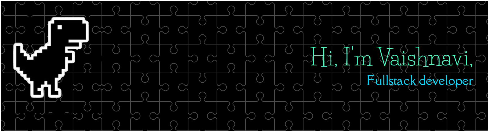

<h1>😺</h1>

🌷 Practical ideas · thoughtful interfaces · a little cat magic 🐈‍⬛

[🧩 Browse projects](https://github.com/papnoivaishnavi?tab=repositories) &nbsp; ✦ &nbsp; [📈 View profile activity](https://github.com/papnoivaishnavi?tab=overview)

---

## 🌸 A little about me

<table>
  <tr>
<td valign="middle" width="70%">

  
🌍 <strong>Beyond code:</strong>

  <ul>
    <li>Anime enthusiast — <em>Hunter x Hunter</em> has a special place on my list.</li>
    <li>Learning languages: Korean 🇰🇷, Japanese 🇯🇵, and French 🇫🇷.</li>
    <li>Always curious about different cultures, ideas, and perspectives.</li>
    <li>Enjoy discovering opportunities, meeting new people, and learning something unexpected along the way.</li>
  </ul>

  
I believe there's always something new to discover, build, or learn.

  
<strong>Thanks for stopping by. Nice to have ya!</strong> ✨

</td>
  </tr>
</table>

---

## 🧰 Tech-stack stickers

  
  
  
  

  
  
  
  

  
  
  
  
  

Some technologies are ongoing learning or exploration, rather than advanced proficiency.

---

## 📌 Projects

### 🔐 VeilDB | Smart Data Masking System for PII Protection

A database-agnostic data protection engine that automatically detects sensitive information and applies dynamic, role-based masking without modifying underlying database records.

- **Focus:** Data privacy, PII detection, database security, and role-based access control (RBAC).
- **Features:** SQLAlchemy database management, query interception, FastAPI REST APIs, dynamic masking strategies, and an interactive Streamlit dashboard.
- **Testing:** 104 tests passed; backend and UI/UX contributions integrated into the main branch.

🔗 [View the VeilDB repository →](https://github.com/papnoivaishnavi/VeilDB)

### 📦 LastMileAI | AI-Powered Smart Locker & Route Optimization

An intelligent logistics project focused on optimizing last-mile delivery through traffic prediction, route planning, and secure parcel locker management.

- **Focus:** AI-driven logistics, route optimization, and smart delivery systems.
- **Features:** LSTM-based traffic prediction, optimized delivery routes, OTP-based parcel collection, and a delivery monitoring dashboard.

🔗 [View the LastMileAI repository →](https://github.com/papnoivaishnavi/LastMileAI)

---

## 📊 GitHub analytics

  
  

  <picture>
    <source media="(prefers-color-scheme: dark)" srcset="./profile/contribution-snake-dark.svg" />
    
  </picture>

---

## 🌐 Find me online

  
  

🐈‍⬛ &nbsp; ✨ &nbsp; 🐾 &nbsp; ✨ &nbsp; 🐈

