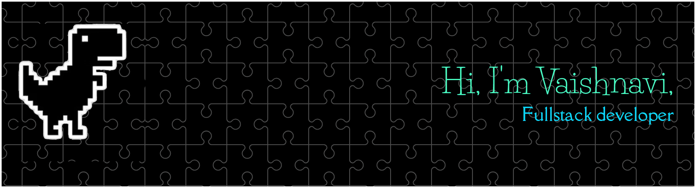
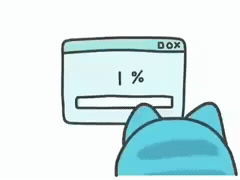

<h1>Vaishnavi Papnoi</h1>

🌷 Practical ideas · thoughtful interfaces · a little cat magic 🐈‍⬛

[🧩 Browse projects](https://github.com/papnoivaishnavi?tab=repositories) &nbsp; ✦ &nbsp; [📈 View profile activity](https://github.com/papnoivaishnavi?tab=overview)

---

## 🌸 A little about me

<table>
  <tr>
    <td valign="middle" width="70%">
      
I'm Vaishnavi Papnoi, a Computer Science Engineering student interested in building practical technology solutions through software development, AI/ML, and interactive web experiences.

      
I enjoy researching problems, designing user-friendly interfaces, and turning ideas into prototypes. I'm strengthening my programming fundamentals while exploring technologies and building projects around real-world problems.

      
🌱 <strong>Currently learning:</strong> Data Structures & Algorithms, Java, and OOP.

    </td>
    <td align="center" valign="middle" width="30%">
      
    </td>
  </tr>
</table>

---

## 🧰 Tech-stack stickers

  
  
  
  

  
  
  
  

  
  
  
  
  

Some technologies are ongoing learning or exploration, rather than advanced proficiency.

---

## 📌 The project pinboard

<table>
  <tr>
    <td valign="top" width="50%">
      <h3>📦 AidLogistix</h3>
      
A disaster-relief logistics and inventory dashboard concept.

      <ul>
        <li><strong>Focus:</strong> relief inventory and resource coordination.</li>
        <li><strong>Design consideration:</strong> low-bandwidth and offline usability.</li>
        <li><strong>Potential users:</strong> relief teams and inventory coordinators.</li>
        <li><strong>Status:</strong> Selected for Smart India Hackathon 2026 — National Level.</li>
        <li><strong>Team ID:</strong> 136604.</li>
      </ul>
    </td>
    <td valign="top" width="50%">
      <h3>💳 SecurePay — UI/UX & 3D Website Design</h3>
      
A fintech design challenge entry for Unstop, focused on polished interfaces and interactive website experiences.

      <ul>
        <li><strong>Focus:</strong> UI/UX, visual design, and 3D web concepts.</li>
        <li><strong>Contribution:</strong> design and website experience.</li>
        <li><strong>Team achievement:</strong> our team ranked in the <strong>Top 3</strong> in the challenge.</li>
      </ul>
    </td>
  </tr>
  <tr>
    <td colspan="2" valign="top">
      <h3>🏙️ City Trash / Landfill Lifespan Calculator</h3>
      
A featured landfill analytics project associated with the Tarang 2.0 challenge at GTBIT. It explores how dashboards and visual analytics can make landfill data easier to interpret.

      <ul>
        <li><strong>Focus:</strong> waste management and landfill lifespan estimation.</li>
        <li><strong>Features:</strong> dashboard, visual analytics, and Monte Carlo simulation concepts.</li>
        <li><strong>Technologies:</strong> HTML, JavaScript, Chart.js, and data visualization.</li>
      </ul>
      
🔗 <a href="https://github.com/jasneetkr-1610/Delhi-Landfill-Intelligence">View the Delhi Landfill Intelligence repository →</a>

    </td>
  </tr>
</table>

---

## 🏆 Achievements & experiences

<table>
  <tr>
    <td valign="top" width="50%">
      
🎖️ <strong>Smart India Hackathon 2026</strong> Selected for the National Level.

    </td>
    <td valign="top" width="50%">
      
🥇 <strong>SecurePay Design Challenge</strong> Our team ranked in the Top 3.

    </td>
  </tr>
  <tr>
    <td valign="top" width="50%">
      
🎓 <strong>IIT Mandi</strong> Selected for a sponsored four-day Climate-Controlled Agri Automation & AI Workshop in September 2026.

    </td>
    <td valign="top" width="50%">
      
🌿 <strong>AgriTech & Automation</strong> Explored Arduino, ESP32, sensors, ThingSpeak, data analysis, machine-learning workflows, and RAG-based systems.

    </td>
  </tr>
  <tr>
    <td valign="top" width="50%">
      
💡 <strong>Business Blasters 2023-2024</strong> Advanced from the top 3,000 to the top 1,000 in a Delhi government school entrepreneurship competition.

    </td>
    <td valign="top" width="50%">
      
🧪 <strong>TARANG 2.0 | DEPARTMENT OF APPLIED SCIENCES, GTBIT</strong> Worked on a landfill analytics and waste-management concept.

    </td>
  </tr>
</table>

---

## 📊 GitHub analytics

  
  

  <picture>
    <source media="(prefers-color-scheme: dark)" srcset="./profile/contribution-snake-dark.svg" />
    
  </picture>

<a href="https://github.com/papnoivaishnavi?tab=overview">See the contribution graph and activity on my GitHub profile →</a>

Profile cards refresh daily with public GitHub data.

---

## 🌐 Find me online

🐈‍⬛ &nbsp; ✨ &nbsp; 🐾 &nbsp; ✨ &nbsp; 🐈

