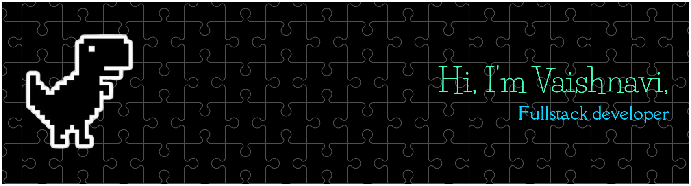

### 🌸 A cozy corner for code, creativity, and cat energy 🐈

Projects, experiments, and ideas in progress — with a little anime magic along the way.

[🧩 Explore the repositories](https://github.com/papnoivaishnavi?tab=repositories) &nbsp; ✦ &nbsp; [📈 See profile activity](https://github.com/papnoivaishnavi?tab=overview)

 

<table>
  <tr>
    <td align="center" width="33%">
      <strong>🧩 Projects</strong>  Builds, experiments & ideas
    </td>
    <td align="center" width="33%">
      <strong>🌸 Aesthetic</strong>  Anime-inspired, soft & playful
    </td>
    <td align="center" width="33%">
      <strong>🐾 Sidekicks</strong>  Cats, always cats
    </td>
  </tr>
</table>

 

### ✨ Take a look around

Browse the repos for new projects and little experiments. Thanks for stopping by! 🐈‍⬛

